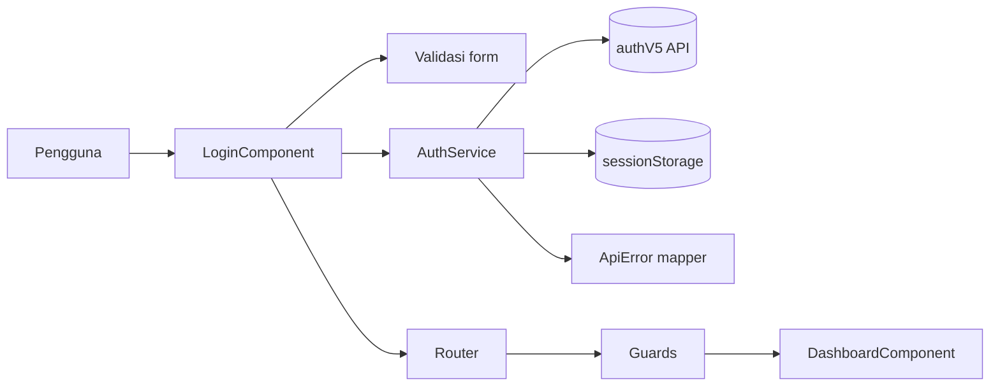
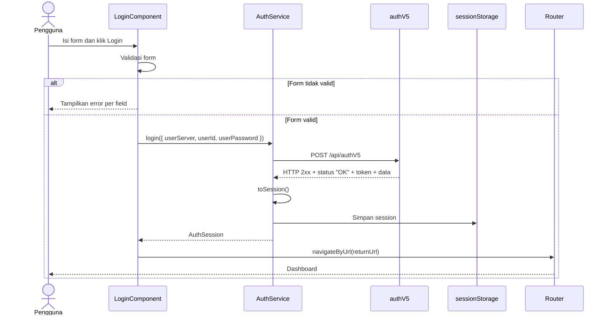
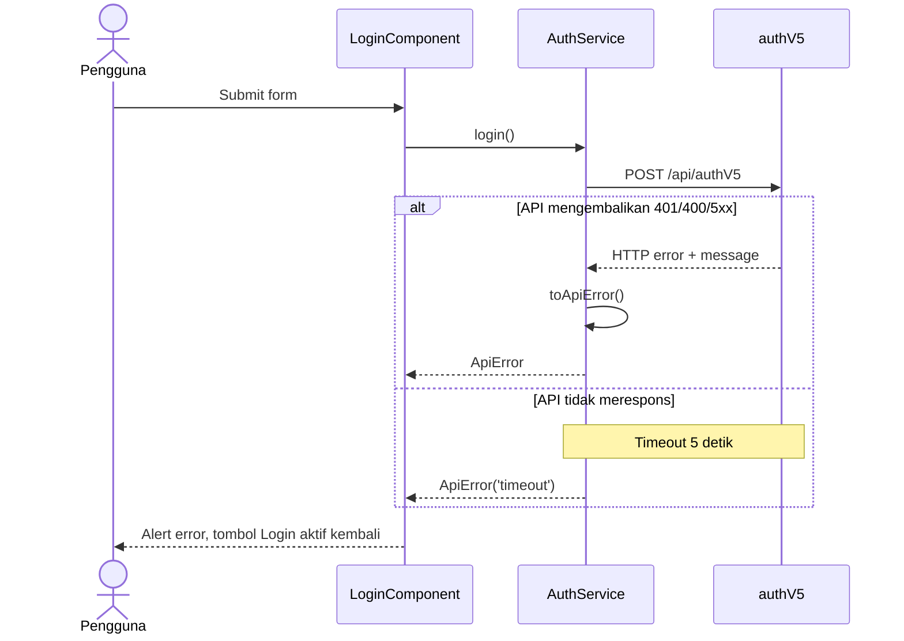

# Dokumentasi Project — Simple Login Page

Dokumen ini menjelaskan arsitektur, alur kerja, integrasi API, penanganan error, testing,
dan panduan pengembangan lanjutan untuk project **Simple Login Page**.

Terakhir diperbarui: 21 Oktober 2026.

## Daftar isi

- [Dokumentasi Project — Simple Login Page](#dokumentasi-project--simple-login-page)
  - [Daftar isi](#daftar-isi)
  - [1. Ringkasan project](#1-ringkasan-project)
    - [Status implementasi](#status-implementasi)
  - [2. Teknologi](#2-teknologi)
  - [3. Menjalankan project](#3-menjalankan-project)
    - [Prasyarat](#prasyarat)
    - [Perintah](#perintah)
  - [4. Struktur project](#4-struktur-project)
    - [Tanggung jawab tiap bagian](#tanggung-jawab-tiap-bagian)
  - [5. Arsitektur](#5-arsitektur)
  - [6. Alur login](#6-alur-login)
    - [6.1 Alur sukses](#61-alur-sukses)
    - [6.2 Alur error](#62-alur-error)
    - [6.3 Perilaku API yang perlu diketahui](#63-perilaku-api-yang-perlu-diketahui)
  - [7. Integrasi API](#7-integrasi-api)
    - [7.1 Endpoint dan payload](#71-endpoint-dan-payload)
    - [7.2 Bentuk response sukses](#72-bentuk-response-sukses)
    - [7.3 Konfigurasi](#73-konfigurasi)
    - [7.4 Timeout](#74-timeout)
  - [8. State dan session](#8-state-dan-session)
    - [8.1 Session](#81-session)
    - [8.2 Pemeriksaan token](#82-pemeriksaan-token)
    - [8.3 State reaktif](#83-state-reaktif)
    - [8.4 Logout](#84-logout)
  - [9. Routing dan navigation](#9-routing-dan-navigation)
  - [10. Form dan validasi](#10-form-dan-validasi)
  - [11. Penanganan error](#11-penanganan-error)
  - [12. UI, styling, dan responsive](#12-ui-styling-dan-responsive)
    - [12.1 Design token](#121-design-token)
    - [12.2 Layout login](#122-layout-login)
    - [12.3 Layout dashboard](#123-layout-dashboard)
    - [12.4 Aksesibilitas](#124-aksesibilitas)
    - [12.5 Hasil pengecekan responsive](#125-hasil-pengecekan-responsive)
  - [13. Testing](#13-testing)
    - [13.1 File test](#131-file-test)
    - [13.2 Pola yang dipakai](#132-pola-yang-dipakai)
    - [13.3 Menjalankan](#133-menjalankan)
    - [13.4 Belum ada](#134-belum-ada)
  - [14. Panduan pengembangan lanjutan](#14-panduan-pengembangan-lanjutan)
    - [14.1 Menambah halaman baru](#141-menambah-halaman-baru)
    - [14.2 Menambah endpoint API](#142-menambah-endpoint-api)
    - [14.3 Menambah jenis error baru](#143-menambah-jenis-error-baru)
    - [14.4 Mengubah endpoint atau timeout](#144-mengubah-endpoint-atau-timeout)
    - [14.5 Konvensi kode](#145-konvensi-kode)
    - [14.6 Debugging](#146-debugging)
  - [15. Troubleshooting](#15-troubleshooting)
  - [16. Keterbatasan dan technical debt](#16-keterbatasan-dan-technical-debt)
  - [17. Roadmap yang disarankan](#17-roadmap-yang-disarankan)
  - [18. Keputusan desain](#18-keputusan-desain)
  - [19. Checklist deployment](#19-checklist-deployment)
  - [20. Referensi](#20-referensi)

---

## 1. Ringkasan project

Simple Login Page adalah halaman login yang dibuat untuk technical test Frontend Developer.
Aplikasi terintegrasi dengan API `POST http://cool.uruz.id/api/authV5`, lalu mengarahkan
pengguna ke halaman dashboard setelah login berhasil.

Ruang lingkup utama:

- Form login: **User Server**, **User ID**, dan **Password**.
- Validasi form di sisi client.
- Integrasi API `authV5`.
- Penanganan response code API dan kondisi jaringan.
- Redirect ke dashboard, proteksi route, dan logout.
- UI responsive dengan pesan error yang jelas.

### Status implementasi

| Requirement                                        | Status             |
| -------------------------------------------------- | ------------------ |
| Field User Server, User ID, Password, tombol Login | Selesai            |
| Tampilan sederhana, rapi, responsive               | Selesai            |
| Integrasi API `authV5`                             | Selesai            |
| Menampilkan error dari API                         | Selesai            |
| Handling HTTP response code                        | Selesai            |
| Routing/navigation                                 | Selesai            |
| Form handling & validation                         | Selesai            |
| Code structure & readability                       | Selesai            |
| Testing                                            | 13 unit test lulus |
| Build production                                   | Berhasil           |

---

## 2. Teknologi

| Teknologi       | Versi / keterangan                                                        |
| --------------- | ------------------------------------------------------------------------- |
| Angular         | 22.2.x, standalone components, signals                                    |
| TypeScript      | 6.0.x, beberapa pemeriksaan tambahan aktif (strict mode belum diaktifkan) |
| RxJS            | 7.8.x                                                                     |
| Reactive Forms  | `@angular/forms`                                                          |
| Styling         | SCSS, CSS variables                                                       |
| Test runner     | Vitest 5 via Angular test builder                                         |
| HTTP            | `HttpClient` dengan `withFetch()`                                         |
| Package manager | npm 11.x                                                                  |

Kebutuhan Node.js mengikuti Angular 22: `^22.22.3 || ^24.15.0 || >=26.0.0`.
Environment pengembangan saat ini menggunakan Node `24.20.0`.

---

## 3. Menjalankan project

### Prasyarat

- Node.js sesuai kebutuhan Angular 22.
- npm.
- Akses jaringan ke `http://cool.uruz.id`.

### Perintah

```bash
# Install dependency (gunakan npm ci untuk build reproducible)
npm ci

# Jalankan development server
npm start
# Buka http://localhost:4200/

# Build production
npm run build
# Output: dist/simple-login-page/browser

# Jalankan unit test (watch mode)
npm test

# Jalankan unit test sekali saja (cocok untuk CI)
npm test -- --watch=false
```

---

## 4. Struktur project

```text
simple-login-page/
├── src/
│   ├── main.ts                         # Bootstrap aplikasi
│   ├── index.html                      # HTML shell, font, meta viewport
│   ├── styles.scss                     # Design token & style global
│   └── app/
│       ├── app.ts / app.html / app.scss
│       ├── app.config.ts               # Provider global
│       ├── app.routes.ts               # Definisi route
│       ├── app.spec.ts
│       ├── core/
│       │   ├── config/
│       │   │   └── api.config.ts       # Injection token + konfigurasi API
│       │   ├── errors/
│       │   │   └── api-error.ts        # ApiError & mapper HTTP -> pesan user
│       │   ├── guards/
│       │   │   └── auth.guard.ts       # authGuard & guestGuard
│       │   ├── models/
│       │   │   └── auth.model.ts       # Tipe request/response/session
│       │   ├── services/
│       │   │   ├── auth.service.ts     # Login, session, logout
│       │   │   └── auth.service.spec.ts
│       │   └── validators/
│       │       └── not-blank.validator.ts
│       └── features/
│           ├── login/
│           │   ├── login.component.ts
│           │   ├── login.component.html
│           │   ├── login.component.scss
│           │   └── login.component.spec.ts
│           └── dashboard/
│               ├── dashboard.component.ts
│               ├── dashboard.component.html
│               └── dashboard.component.scss
├── angular.json
├── package.json
├── tsconfig*.json
├── DOCUMENTATION.md                    # Dokumen ini
└── README.md                           # Ringkasan cepat
```

### Tanggung jawab tiap bagian

| File                                     | Tanggung jawab                                                                            |
| ---------------------------------------- | ----------------------------------------------------------------------------------------- |
| `src/app/app.config.ts`                  | Mendaftarkan router, HttpClient, dan konfigurasi API.                                     |
| `src/app/app.routes.ts`                  | Route `/login`, `/dashboard`, redirect, dan lazy loading.                                 |
| `core/config/api.config.ts`              | `API_CONFIG` token, endpoint, timeout, dan default payload.                               |
| `core/errors/api-error.ts`               | Mengubah `HttpErrorResponse` menjadi `ApiError` dengan pesan yang ramah pengguna.         |
| `core/services/auth.service.ts`          | Request login, timeout, pemetaan response, penyimpanan session, logout.                   |
| `core/guards/auth.guard.ts`              | `authGuard` melindungi dashboard; `guestGuard` mencegah user login membuka halaman login. |
| `core/models/auth.model.ts`              | Kontrak tipe data request, response API, user, dan session.                               |
| `core/validators/not-blank.validator.ts` | Menolak input yang hanya berisi spasi.                                                    |
| `features/login/*`                       | Form login, validasi, tampilan error, redirect setelah sukses.                            |
| `features/dashboard/*`                   | Menampilkan user yang sedang login dan tombol logout.                                     |
| `src/styles.scss`                        | Design token global, style tombol, fokus, dan preferensi reduced motion.                  |

---

## 5. Arsitektur

Project menggunakan pemisahan sederhana antara **core** (logika lintas fitur) dan
**features** (halaman/UI).



Prinsip yang dipakai:

- **Standalone components** tanpa `NgModule`.
- **Signals** untuk state lokal/UI (`submitting`, `submitted`, `showPassword`, `errorMessage`)
  dan state session di service.
- **Reactive Forms** untuk validasi dan kontrol form.
- **Service terpusat** untuk autentikasi agar komponen tidak berurusan langsung dengan HTTP.
- **Error mapper terpisah** agar pemetaan HTTP status mudah diuji dan diubah.
- **Injection token** `API_CONFIG` agar endpoint/timeout bisa diganti tanpa mengubah service.

---

## 6. Alur login

### 6.1 Alur sukses



### 6.2 Alur error



### 6.3 Perilaku API yang perlu diketahui

Berdasarkan pengujian langsung ke API:

- Login sukses mengembalikan **HTTP 201 Created**, bukan 200. Body berisi
  `status: "OK"`, `token`, dan array `data`.
- Password salah mengembalikan **HTTP 401** dengan body:
  `{"status":"NOT OK","message":"Kombinasi id dan password yang anda masukkan salah."}`
- `userServer` yang tidak dikenal **tidak mengirim respons apa pun** (sudah diuji hingga
  120 detik tanpa byte diterima). Karena itu aplikasi memakai timeout 5 detik.
- Response sukses berukuran besar karena menyertakan data privilege, `data2`, dan `data3`.
  Aplikasi hanya mengambil `data[0]` dan field user yang dibutuhkan.

---

## 7. Integrasi API

### 7.1 Endpoint dan payload

- **Method:** `POST`
- **URL:** `http://cool.uruz.id/api/authV5`
- **Header:** `Content-Type: application/json`

Payload yang dikirim:

```json
{
  "from_origin": "*",
  "userServer": "cooluruz",
  "userId": "admin",
  "userPassword": "admin",
  "envServer": "dev",
  "referrer": "bodev.uruz.id"
}
```

Nilai default `from_origin`, `envServer`, dan `referrer` berada di
`src/app/core/config/api.config.ts`.

### 7.2 Bentuk response sukses

Response asli sangat besar; bentuk yang relevan:

```json
{
  "status": "OK",
  "token": "eyJhbGciOiJIUzI1NiIs...",
  "data": [
    {
      "id": "admin",
      "name": "Admin",
      "email": "admin@example.com",
      "group_id": "ADMIN",
      "jabatan_name": "Big Boss",
      "branch_id": "PUSAT",
      "branch_name": "CABANG PUSAT"
    }
  ]
}
```

Aplikasi menganggap login berhasil jika:

1. HTTP request sukses (2xx).
2. `response.status === "OK"`.
3. `response.token` berupa string dan tidak kosong.
4. `response.data[0]` tersedia.

Jika salah satu gagal, service melempar `ApiError('invalidResponse', ...)` dengan pesan dari
API atau pesan fallback.

### 7.3 Konfigurasi

`src/app/core/config/api.config.ts`:

```ts
export const DEFAULT_API_CONFIG: ApiConfig = {
  authUrl: 'http://cool.uruz.id/api/authV5',
  timeoutMs: 5_000,
  defaults: {
    fromOrigin: '*',
    envServer: 'dev',
    referrer: 'bodev.uruz.id',
  },
};
```

Untuk mengganti konfigurasi tanpa mengubah default, override provider di
`src/app/app.config.ts`:

```ts
{ provide: API_CONFIG, useValue: { ...DEFAULT_API_CONFIG, authUrl: 'https://...' } }
```

### 7.4 Timeout

Timeout diterapkan di `AuthService.login()` menggunakan operator `timeout` dari RxJS:

```ts
timeout({
  first: this.config.timeoutMs,
  with: () =>
    throwError(
      () =>
        new ApiError(
          'timeout',
          0,
          `Server tidak merespons dalam ${this.config.timeoutMs / 1000} detik. ` +
            'Periksa kembali User Server yang Anda masukkan.',
        ),
    ),
}),
```

Catatan:

- Timeout hanya menunggu emission pertama; response HTTP hanya menghasilkan satu emission.
- Saat timeout terjadi, subscription dibatalkan. Dengan backend `fetch`, request ikut
  di-abort.
- Nilai 5 detik dipilih karena login normal selesai sekitar 0,15–0,3 detik. Nilai dapat
  dinaikkan jika jaringan pengguna lambat.

---

## 8. State dan session

### 8.1 Session

Session disimpan di `sessionStorage` dengan key:

```text
simple-login.session
```

Bentuk data:

```ts
interface AuthSession {
  token: string;
  user: {
    id: string;
    name: string;
    jabatanName: string;
    branchName: string;
  };
}
```

Session bersifat **per-tab** dan hilang saat tab ditutup. Ini cukup untuk kebutuhan login
sederhana dan menghindari session yang tertinggal terlalu lama.

### 8.2 Pemeriksaan token

Saat service dibuat, `readStoredSession()` membaca session dari storage. Token JWT
diperiksa:

- Payload JWT di-decode dari bagian kedua token.
- Jika `exp` ada dan `exp * 1000 <= Date.now()`, session dianggap kedaluwarsa.
- Token yang tidak bisa di-parse juga dianggap tidak valid.
- Session yang tidak valid dihapus dari storage.

### 8.3 State reaktif

`AuthService` menyimpan state di signal:

```ts
private readonly sessionState = signal<AuthSession | null>(this.readStoredSession());
readonly session = this.sessionState.asReadonly();
readonly isAuthenticated = computed(() => this.sessionState() !== null);
```

Dashboard menggunakan `computed` untuk menampilkan user aktif. Guard membaca
`isAuthenticated()`.

### 8.4 Logout

`AuthService.logout()`:

1. Mengosongkan signal session.
2. Menghapus `simple-login.session` dari `sessionStorage`.
3. Navigasi ke `/login`.

---

## 9. Routing dan navigation

Definisi route ada di `src/app/app.routes.ts`.

| Path         | Component            | Guard        | Keterangan                                                   |
| ------------ | -------------------- | ------------ | ------------------------------------------------------------ |
| `/login`     | `LoginComponent`     | `guestGuard` | Halaman login; user yang sudah login diarahkan ke dashboard. |
| `/dashboard` | `DashboardComponent` | `authGuard`  | Halaman setelah login.                                       |
| `''`         | —                    | —            | Redirect ke `/dashboard`.                                    |
| `**`         | —                    | —            | Redirect ke `/login`.                                        |

Detail:

- Komponen di-lazy-load dengan `loadComponent`.
- Route memiliki `title` (`Login`, `Dashboard`).
- `authGuard` mengarahkan user yang belum login ke
  `/login?returnUrl=<url-yang-dituju>`.
- `guestGuard` mencegah user yang sudah login membuka `/login`.
- `LoginComponent` membaca `returnUrl` dan memvalidasinya lewat `safeReturnUrl()`:
  - Harus diawali `/`.
  - Tidak boleh diawali `//` (menghindari open redirect).
  - Tidak boleh mengarah ke `/login`.
  - Jika tidak valid, fallback ke `/dashboard`.

---

## 10. Form dan validasi

Form menggunakan `NonNullableFormBuilder`.

| Field          | Validator                               | Pesan error                                                  |
| -------------- | --------------------------------------- | ------------------------------------------------------------ |
| `userServer`   | `required`, `notBlank`, `maxLength(50)` | Wajib diisi / tidak boleh hanya spasi / maksimal 50 karakter |
| `userId`       | `required`, `notBlank`, `maxLength(50)` | Sama seperti di atas                                         |
| `userPassword` | `required`                              | Wajib diisi                                                  |

Perilaku form:

- Error field baru ditampilkan setelah field disentuh atau form sudah pernah disubmit.
- Saat submit, `markAllAsTouched()` dipanggil.
- `userServer` dan `userId` di-`trim()` sebelum dikirim ke API.
- Password tidak di-trim.
- Tombol Login disabled selama request berjalan dan menampilkan spinner + “Memproses...”.
- Pesan error API dibersihkan otomatis ketika pengguna mengubah nilai form.
- Tombol tampil/sembunyikan password memakai `aria-pressed`.
- Form memakai `novalidate` agar validasi konsisten di semua browser.

---

## 11. Penanganan error

Pemetaan utama ada di `src/app/core/errors/api-error.ts`.

| Kondisi                                                         | `ApiError.kind`   | Pesan yang ditampilkan                                                                                                          |
| --------------------------------------------------------------- | ----------------- | ------------------------------------------------------------------------------------------------------------------------------- |
| Status HTTP `0`                                                 | `network`         | Tidak dapat terhubung ke server. Periksa koneksi internet.                                                                      |
| HTTP `401` / `403`                                              | `unauthorized`    | `message` dari API, atau “ID pengguna atau password tidak sesuai.”                                                              |
| HTTP `400` / `422`                                              | `badRequest`      | `message` dari API, atau “Data yang dikirim tidak valid.”                                                                       |
| HTTP `>= 500`                                                   | `server`          | “Server sedang bermasalah (HTTP xxx). Silakan coba beberapa saat lagi.”                                                         |
| HTTP 2xx tetapi body tidak bisa dibaca                          | `invalidResponse` | “Respons server tidak dapat dibaca.”                                                                                            |
| HTTP 2xx, body kosong / `status` bukan `OK` / token tidak valid | `invalidResponse` | `message` dari API atau “Login gagal: respons server tidak valid.”                                                              |
| Tidak ada respons dalam 5 detik                                 | `timeout`         | “Server tidak merespons dalam 5 detik. Periksa kembali User Server...”                                                          |
| Error lain                                                      | `unknown`         | `message` dari API atau “Terjadi kesalahan saat memproses permintaan Anda (HTTP xxx). Silakan coba lagi setelah beberapa saat.” |

Di UI:

- Error API ditampilkan di `<div class="alert" role="alert">`.
- Error field ditampilkan inline di bawah input.
- Input yang invalid mendapat `aria-invalid` dan `aria-describedby`.
- Setelah error, `submitting` di-reset sehingga pengguna bisa mencoba lagi.

Catatan: HTTP `408` dan `429` belum dipetakan khusus; keduanya masuk ke fallback
`unknown`. API yang dipakai saat ini tidak mengembalikan kode tersebut.

---

## 12. UI, styling, dan responsive

### 12.1 Design token

Token global ada di `src/styles.scss`:

```css
:root {
  --color-bg: #0b1a1d;
  --color-surface: #112529;
  --color-surface-deep: #081316;
  --color-input: #0e1f23;
  --color-text: #e4efe9;
  --color-muted: #8ba3a0;
  --color-line: #1f3b40;
  --color-accent: #c6f04e;
  --color-danger: #ff8f7f;
  --font-display: 'Fraunces', Georgia, serif;
  --font-body: 'IBM Plex Sans', system-ui, sans-serif;
  --radius: 14px;
  --shadow-card: ...;
}
```

Untuk mengubah tema, cukup ubah nilai token di `styles.scss`; komponen memakai variabel
tersebut.

### 12.2 Layout login

- Dua kolom: brand panel dan panel form.
- Breakpoint `860px`: brand panel disembunyikan, form menjadi satu kolom.
- Panel form maksimal `26rem`, padding memakai `clamp()`.
- Input dan tombol memiliki tinggi minimal `2.75rem` (44px).
- Font input `1rem` untuk mencegah auto-zoom di iOS.

### 12.3 Layout dashboard

- Card maksimal `60rem`.
- Metadata user memakai grid `repeat(auto-fit, minmax(14rem, 1fr))`.
- Padding dan ukuran judul memakai `clamp()`.

### 12.4 Aksesibilitas

- Semua input memiliki `<label>`.
- `aria-invalid` dan `aria-describedby` dihubungkan ke pesan error.
- Alert memakai `role="alert"`.
- Tombol submit memakai `aria-busy` saat memproses.
- Tombol password memakai `aria-pressed`.
- `:focus-visible` memiliki outline yang jelas.
- Mendukung `prefers-reduced-motion`.
- Target sentuh minimal 44px.

### 12.5 Hasil pengecekan responsive

Diuji dengan headless Chrome pada viewport 320, 375, 768, 1024, dan 1440 px:

- Tidak ada horizontal overflow di halaman login maupun dashboard.
- Brand panel tersembunyi di bawah 860px.
- Input dan tombol tetap 44px.
- Card dashboard menyesuaikan lebar tanpa keluar viewport.

---

## 13. Testing

### 13.1 File test

| File                                             | Cakupan                                                                           |
| ------------------------------------------------ | --------------------------------------------------------------------------------- |
| `src/app/app.spec.ts`                            | Root component bisa dibuat.                                                       |
| `src/app/core/services/auth.service.spec.ts`     | Payload, sukses, 401, `status: NOT OK`, body kosong, timeout, network error, 5xx. |
| `src/app/features/login/login.component.spec.ts` | Error timeout, validasi form kosong, trim input, redirect setelah sukses.         |

Total: **13 test** dalam 3 file.

### 13.2 Pola yang dipakai

- `provideHttpClient()` + `provideHttpClientTesting()` untuk service.
- `HttpTestingController` untuk memeriksa request dan mem-flush response.
- `vi.useFakeTimers()` untuk menguji timeout 5 detik.
- `http.verify({ ignoreCancelled: true })` karena request yang timeout dibatalkan.
- Stub `AuthService` untuk test komponen tanpa request HTTP nyata.
- `vi.spyOn(router, 'navigateByUrl')` untuk memverifikasi redirect.

### 13.3 Menjalankan

```bash
npm test -- --watch=false
```

Untuk watch mode:

```bash
npm test
```

### 13.4 Belum ada

- End-to-end test (Playwright/Cypress).
- Visual regression test.
- Coverage threshold di CI.
- Lint/format check otomatis di CI.

---

## 14. Panduan pengembangan lanjutan

### 14.1 Menambah halaman baru

1. Buat komponen standalone di `src/app/features/<nama>/`.
2. Tambahkan route di `src/app/app.routes.ts` dengan `loadComponent`.
3. Tambahkan guard jika halaman membutuhkan login.
4. Tambahkan `title` pada route.
5. Tambahkan link/navigasi dari dashboard jika perlu.

Contoh route:

```ts
{
  path: 'profile',
  canActivate: [authGuard],
  title: 'Profile',
  loadComponent: () =>
    import('./features/profile/profile.component').then((m) => m.ProfileComponent),
}
```

### 14.2 Menambah endpoint API

1. Tambahkan tipe request/response di `core/models/`.
2. Tambahkan method di service terkait (mis. `ProfileService`).
3. Gunakan `HttpClient` dan `catchError((error) => throwError(() => toApiError(error)))`.
4. Pertimbangkan `timeout` jika endpoint bisa menggantung.
5. Tambahkan unit test dengan `HttpTestingController`.

Jika endpoint membutuhkan token, buat HTTP interceptor agar token tidak perlu ditempel
manual di setiap service.

### 14.3 Menambah jenis error baru

1. Tambahkan nilai ke `ApiErrorKind`.
2. Petakan status/kondisi di `toApiError()`.
3. Tentukan pesan yang ramah pengguna.
4. Tambahkan test di `auth.service.spec.ts`.
5. Jika perlu, sesuaikan tampilan di `LoginComponent`.

### 14.4 Mengubah endpoint atau timeout

- Ubah `DEFAULT_API_CONFIG` di `core/config/api.config.ts`, atau
- Override `API_CONFIG` di `app.config.ts` (disarankan untuk konfigurasi per environment).
- Pastikan nilai timeout tetap masuk akal dengan latensi API.
- Tambahkan test jika perubahan memengaruhi perilaku error.

### 14.5 Konvensi kode

- Gunakan standalone component dan `inject()`.
- Gunakan signals untuk state UI lokal.
- Gunakan `ChangeDetectionStrategy.OnPush` untuk komponen baru.
- Jaga pemisahan `core/` (logika lintas fitur) dan `features/` (UI per halaman).
- Gunakan tipe eksplisit untuk kontrak API.
- Jalankan Prettier untuk file yang diubah.
- Tambahkan test untuk perilaku baru, terutama error handling.

### 14.6 Debugging

- Buka DevTools → Network untuk melihat status, payload, dan response API.
- Jika status `0`, periksa koneksi, CORS, atau mixed content (HTTP dari halaman HTTPS).
- Jika User Server salah, request memang tidak akan pernah merespons; tunggu timeout 5 detik.
- Jika session hilang setelah refresh, periksa `exp` pada JWT dan isi `sessionStorage`.
- Untuk test timeout, pastikan fake timer direset dengan `vi.useRealTimers()` di `afterEach`.

---

## 15. Troubleshooting

| Masalah                                  | Penyebab                                      | Solusi                                                         |
| ---------------------------------------- | --------------------------------------------- | -------------------------------------------------------------- |
| Port 4200 sudah dipakai                  | Dev server lain masih berjalan                | Hentikan proses lama atau jalankan `npm start -- --port 4300`. |
| User Server benar tetapi timeout         | Jaringan lambat / API lambat                  | Coba lagi; naikkan `timeoutMs` jika sering terjadi.            |
| User Server salah menunggu 5 detik       | API tidak membalas untuk server tidak dikenal | Perilaku normal; pesan timeout akan muncul.                    |
| Muncul “Tidak dapat terhubung ke server” | Offline, CORS, atau mixed content             | Periksa Network tab, protokol halaman, dan header CORS.        |
| Session hilang setelah refresh           | Token kedaluwarsa atau storage dibersihkan    | Login ulang; periksa `exp` JWT.                                |
| Test timeout menggantung                 | Fake timer tidak direset                      | Pastikan `vi.useRealTimers()` di `afterEach`.                  |
| Build warning ukuran komponen            | Style komponen melebihi budget                | Sesuaikan budget di `angular.json` atau pecah style.           |
| Font tidak sesuai                        | Google Fonts diblokir                         | Fallback ke Georgia/system-ui sudah tersedia.                  |

---

## 16. Keterbatasan dan technical debt

Hal-hal berikut bukan blocker untuk technical test, tetapi perlu diperhatikan saat
pengembangan produksi:

1. **URL API hardcoded HTTP.**
   Jika aplikasi di-deploy lewat HTTPS, request ke HTTP akan diblokir browser (mixed
   content). Pindahkan URL ke environment config dan gunakan HTTPS.
2. **Belum ada environment files.**
   `from_origin`, `envServer`, dan `referrer` masih default di kode.
3. **Belum ada interceptor token.**
   Token hanya disimpan; belum ada request terautentikasi selain login.
4. **Belum ada refresh token / penanganan 401 global.**
   Jika token kedaluwarsa di tengah sesi, belum ada mekanisme refresh otomatis.
5. **Belum ada e2e test dan CI.**
   Verifikasi alur login masih manual/unit test.
6. **Belum ada lint script.**
   Prettier tersedia, tetapi belum ada ESLint di pipeline.
7. **HTTP 408/429 belum dipetakan khusus.**
   Masuk fallback `unknown`.
8. **Timeout 5 detik adalah trade-off.**
   Cepat memberi feedback untuk User Server salah, tetapi bisa false positive di jaringan
   sangat lambat.
9. **Teks UI hardcoded dalam Bahasa Indonesia.**
   Belum ada i18n.
10. **Payload sukses besar tidak sepenuhnya dipakai.**
    Hanya `data[0]` dan beberapa field yang dipetakan; privilege/data2/data3 diabaikan.
11. **`LoginComponent` belum memakai `OnPush`.**
    Dashboard sudah; login masih default change detection.
12. **Session di `sessionStorage` rentan terhadap XSS.**
    Ini konsekuensi menyimpan token di client. Pastikan aplikasi bebas XSS dan
    pertimbangkan cookie `HttpOnly` jika backend mendukung.
13. **TypeScript `strict` dan Angular `strictTemplates` belum diaktifkan.**
    Kode sudah lolos pengecekan `tsc --strict`, jadi mode strict dapat dipertimbangkan
    untuk diaktifkan. `strictTemplates` perlu diuji terlebih dahulu karena memeriksa tipe
    pada template.

---

## 17. Roadmap yang disarankan

Prioritas tinggi:

- Pindahkan konfigurasi API ke environment (`environment.ts` atau file config runtime).
- Gunakan HTTPS untuk endpoint API.
- Tambahkan e2e test untuk alur login, timeout, guard, dan logout.
- Tambahkan ESLint + CI (test + build).

Prioritas menengah:

- Tambahkan HTTP interceptor untuk token dan penanganan 401 global.
- Petakan HTTP 408/429 dan pertimbangkan retry terbatas.
- Tambahkan i18n jika aplikasi akan mendukung beberapa bahasa.
- Tambahkan `OnPush` di `LoginComponent`.
- Aktifkan TypeScript `strict` dan Angular `strictTemplates`.

Prioritas rendah:

- Refresh token otomatis.
- Role-based routing.
- Dashboard dengan data tambahan.
- Audit aksesibilitas dengan axe.
- Visual regression test.

---

## 18. Keputusan desain

| Keputusan                            | Alasan                                                                                                                 |
| ------------------------------------ | ---------------------------------------------------------------------------------------------------------------------- |
| Timeout 5 detik                      | API tidak merespons untuk User Server salah; timeout mencegah spinner tanpa batas. Login normal hanya ~0,15–0,3 detik. |
| `sessionStorage`                     | Cukup untuk session per-tab, sederhana, tidak perlu state server tambahan.                                             |
| Signals                              | Ringan, tidak perlu state management library untuk skala aplikasi ini.                                                 |
| Service + error mapper terpisah      | Memisahkan HTTP, pemetaan error, dan UI agar mudah diuji dan diubah.                                                   |
| Standalone components + lazy loading | Mengikuti gaya Angular modern dan menjaga initial bundle tetap kecil.                                                  |
| `withFetch()`                        | Backend HttpClient modern; request dapat di-abort saat subscription dibatalkan.                                        |
| Guard untuk route                    | Mencegah akses dashboard tanpa session dan mencegah user login membuka halaman login.                                  |
| `returnUrl` divalidasi               | Menghindari open redirect dan mengembalikan user ke halaman yang dituju.                                               |

---

## 19. Checklist deployment

- [ ] `npm ci`
- [ ] `npm test -- --watch=false`
- [ ] `npm run build`
- [ ] Sajikan `dist/simple-login-page/browser` dengan SPA fallback ke `index.html`.
- [ ] Pastikan endpoint API menggunakan HTTPS.
- [ ] Verifikasi CORS dari domain produksi.
- [ ] Verifikasi deep link `/dashboard` tidak 404 (server fallback).
- [ ] Periksa cache header untuk asset ber-hash.
- [ ] Uji login sukses, password salah, User Server salah, dan logout.
- [ ] Pertimbangkan Content Security Policy (CSP).

---

## 20. Referensi

- Angular: <https://angular.dev/>
- Angular Router: <https://angular.dev/guide/routing>
- Reactive Forms: <https://angular.dev/guide/forms/reactive-forms>
- Angular HttpClient: <https://angular.dev/guide/http>
- RxJS `timeout`: <https://rxjs.dev/api/operators/timeout>
- Vitest: <https://vitest.dev/>
